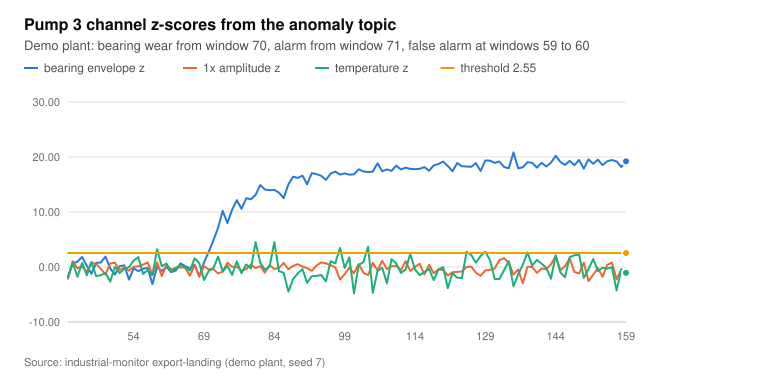
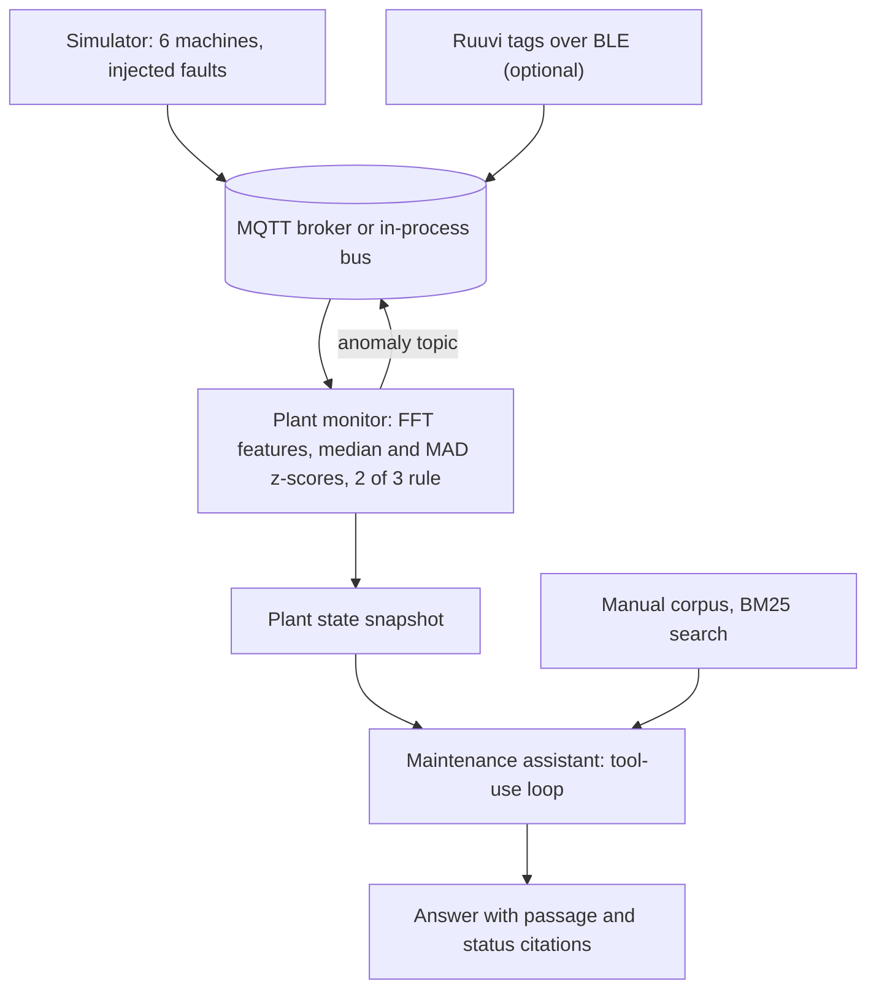
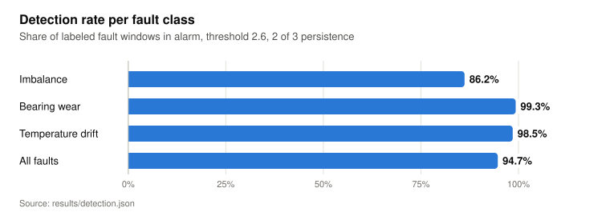
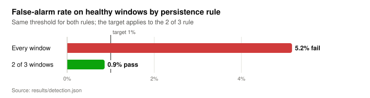
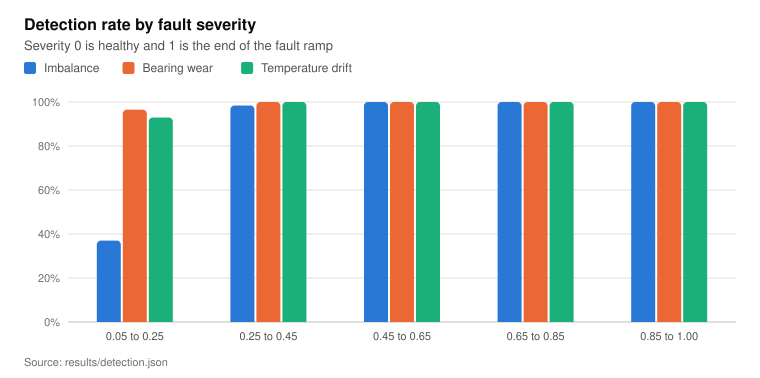
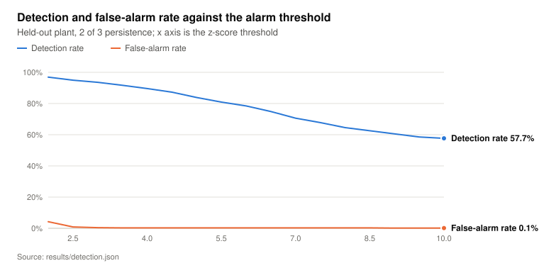
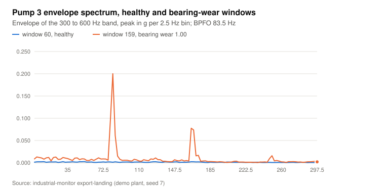
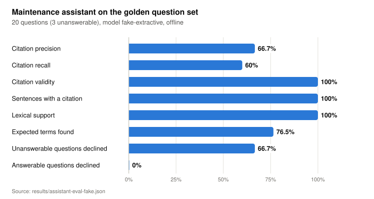

# industrial-monitor

Condition monitoring for pumps and fans: Ruuvi RAWv2 sensor messages over MQTT, FFT vibration features scored by a calibrated anomaly detector, and a maintenance assistant that answers alarm questions with cited manual passages.

<picture>
  <source media="(prefers-color-scheme: dark)" srcset="docs/figures/pump-3-scores-dark.svg">
  
</picture>

Source: chart `pump-3-scores` in [docs/data.json](docs/data.json), written by `industrial-monitor export-landing` from the messages the monitor published on `plant/demo/pump-3/anomaly` during the demo run. The interactive charts are on the landing page, [docs/index.html](docs/index.html), which GitHub Pages serves from `/docs` once it is enabled.

## What it does

- Encodes and decodes Ruuvi RAWv2 (data format 5) payloads and publishes them on `plant/<site>/<machine>/rawv2`, with a project-defined vibration burst of 1,024 acceleration samples at 1,344 Hz on `plant/<site>/<machine>/vibration`.
- Simulates six machines (four pumps, two fans) with injected bearing wear, imbalance and temperature drift. Scanning real Ruuvi tags over BLE is optional (`scan-ble`, extra `ble`).
- Extracts FFT features per window, scores them against a per-machine baseline, applies a 2 of 3 window persistence rule and publishes each machine's state on `plant/<site>/<machine>/anomaly`.
- Measures detection rate and false-alarm rate on labeled simulator faults, with the threshold calibrated on one simulated plant and measured on a second one.
- Answers questions such as "Why is pump 3 alarming and what do I check?" through a tool-use loop over the live plant state and a 30-passage manual corpus. Answers cite manual passages (`[RP-3.2]`) and machine states (`[status:pump-3]`).
- Scores the assistant on a 20-question golden set for citation precision, recall and validity, sentence coverage and lexical support. Tests run offline with a deterministic fake model; `--model claude` calls the Anthropic API.

## How it works



**Ingest.** Each acquisition window produces two messages. The 24-byte RAWv2 payload carries temperature, humidity, pressure, one acceleration sample per axis, battery voltage, transmit power, a movement counter, a sequence number and the MAC address ([ruuvi.py](src/industrial_monitor/ruuvi.py)). One acceleration sample per advertisement cannot resolve a spectrum, so the vibration burst frame has a 13-byte header (version, MAC, sequence, sample rate, sample count) followed by int16 samples in milli-g ([burst.py](src/industrial_monitor/burst.py)). The same code runs on the in-process bus used by the tests and on paho-mqtt with QoS 1 ([bus.py](src/industrial_monitor/bus.py), [mqtt_bus.py](src/industrial_monitor/mqtt_bus.py)).

**Detection.** Each window is Hann-windowed and zero-padded 4 times before the FFT. The detector uses four channels: the 1x running-speed amplitude (imbalance), the envelope spectrum of the housing resonance band at the first three outer-race defect frequency (BPFO) harmonics divided by the median envelope level (bearing wear), the housing temperature (temperature drift) and kurtosis (unclassified). Each channel is scored as a z-score against the median and MAD of the machine's first 40 windows. A channel with a specific fault signature takes precedence over kurtosis when several exceed the threshold, and an alarm needs exceedances in 2 of the last 3 windows ([features.py](src/industrial_monitor/features.py), [detector.py](src/industrial_monitor/detector.py), [monitor.py](src/industrial_monitor/monitor.py)).

**Assistant.** The agent loop is written out by hand so the fake model and Claude run through the same code and every tool call is recorded in the evaluation output ([agent.py](src/industrial_monitor/assistant/agent.py)). Three tools are exposed: `get_machine_status`, `list_alarms` and `search_manual`, a BM25 search over the corpus written with the standard library ([tools.py](src/industrial_monitor/assistant/tools.py), [corpus.py](src/industrial_monitor/assistant/corpus.py)). The system prompt requires a citation on every sentence, allows only citations retrieved in the same run, and fixes the reply "The manual does not cover this." for questions the corpus does not answer. The Claude adapter uses `claude-opus-5-5` with effort `medium` and server-side refusal fallbacks ([claude_model.py](src/industrial_monitor/assistant/claude_model.py)).

## Results

### Detector

The evaluation in [results/detection.json](results/detection.json) uses two simulated plants of 16 machines: four healthy and four per fault class, pumps and fans with varied running amplitude, noise and base temperature. The threshold was calibrated on the development plant (seed 101) to the lowest value with at most 1% false alarms under the 2 of 3 rule, which gave 2.55 with 0.78% false alarms on that plant. The threshold was then frozen and measured on the held-out plant (seed 202), which has different machines, fault onsets and noise: 1,395 healthy and 1,805 fault windows after the 40-window baselines. Reproduce with `uv run industrial-monitor evaluate-detector`.

<picture>
  <source media="(prefers-color-scheme: dark)" srcset="docs/figures/detection-by-fault-dark.svg">
  
</picture>

<details><summary>Data table</summary>

| Item | Value |
|---|---|
| Imbalance | 86.5% |
| Bearing wear | 99.3% |
| Temperature drift | 98.5% |
| All faults | 94.8% |

Source: `results/detection.json`

</details>

<picture>
  <source media="(prefers-color-scheme: dark)" srcset="docs/figures/false-alarm-rate-dark.svg">
  
</picture>

<details><summary>Data table</summary>

| Item | Value |
|---|---|
| Every window | 5.2% (fail) |
| 2 of 3 windows | 0.9% (pass) |

Source: `results/detection.json`

</details>

Alarming on every window above the same threshold raised the false-alarm rate from 0.86% to 5.16% for a detection rate of 95.6% instead of 94.8% ([results/detection.json](results/detection.json), `modes.per_window`). The persistence rule costs alarm delay: the median delay from fault onset to first alarm is 1 window for bearing wear, 2 for temperature drift and 12 for imbalance.

<picture>
  <source media="(prefers-color-scheme: dark)" srcset="docs/figures/detection-by-severity-dark.svg">
  
</picture>

<details><summary>Data table</summary>

|  | Imbalance | Bearing wear | Temperature drift |
|---|---|---|---|
| 0.05 to 0.25 | 38.6% | 96.5% | 93% |
| 0.25 to 0.45 | 98.4% | 100% | 100% |
| 0.45 to 0.65 | 100% | 100% | 100% |
| 0.65 to 0.85 | 100% | 100% | 100% |
| 0.85 to 1.00 | 100% | 100% | 100% |

Source: `results/detection.json`

</details>

<picture>
  <source media="(prefers-color-scheme: dark)" srcset="docs/figures/threshold-sweep-dark.svg">
  
</picture>

<details><summary>Data table</summary>

|  | Detection rate | False-alarm rate |
|---|---|---|
| 2.0 | 96.9% | 4.2% |
| 2.5 | 95% | 0.9% |
| 3.0 | 93.6% | 0.4% |
| 3.5 | 91.7% | 0.3% |
| 4.0 | 89.6% | 0.3% |
| 4.5 | 87.3% | 0.3% |
| 5.0 | 83.9% | 0.3% |
| 5.5 | 80.9% | 0.3% |
| 6.0 | 78.4% | 0.3% |
| 6.5 | 74.8% | 0.3% |
| 7.0 | 70.6% | 0.3% |
| 7.5 | 67.8% | 0.3% |
| 8.0 | 64.5% | 0.3% |
| 8.5 | 62.5% | 0.3% |
| 9.0 | 60.6% | 0.1% |
| 9.5 | 58.6% | 0.1% |
| 10.0 | 57.7% | 0.1% |

Source: `results/detection.json`

</details>

### Signal evidence

The envelope spectrum of pump 3 in the demo plant shows the outer-race defect frequency (BPFO 83.5 Hz) and its harmonics in the faulty window. The 82.5 Hz bin reads 0.001 g in healthy window 60 and 0.200 g in window 159, at fault severity 1.00 ([docs/data.json](docs/data.json), chart `pump-3-envelope`).

<picture>
  <source media="(prefers-color-scheme: dark)" srcset="docs/figures/pump-3-envelope-dark.svg">
  
</picture>

### Maintenance assistant

[results/assistant-eval-fake.json](results/assistant-eval-fake.json) scores the deterministic extractive model on the 20 questions in [eval/golden.jsonl](eval/golden.jsonl): 17 answerable and 3 that the corpus does not cover. They test the evaluation pipeline and set a baseline for it. They do not measure Claude, and no Claude run is recorded in the repository. Reproduce with `uv run industrial-monitor evaluate-assistant`.

<picture>
  <source media="(prefers-color-scheme: dark)" srcset="docs/figures/assistant-metrics-dark.svg">
  
</picture>

<details><summary>Data table</summary>

| Item | Value |
|---|---|
| Citation precision | 66.7% |
| Citation recall | 60% |
| Citation validity | 100% |
| Sentences with a citation | 100% |
| Lexical support | 100% |
| Expected terms found | 76.5% |
| Unanswerable questions declined | 66.7% |
| Answerable questions declined | 0% |

Source: `results/assistant-eval-fake.json`

</details>

| Metric | Definition |
|---|---|
| Citation precision | On the 15 questions with a relevant passage set: cited passages in that set, over all cited passages |
| Citation recall | On the same 15 questions: relevant passages cited, over all relevant passages |
| Citation validity | Citations of passages and machine states that the run retrieved, over all citations |
| Sentences with a citation | Answer sentences containing at least one citation, over all answer sentences |
| Lexical support | Answer sentences with at least 60% of their non-stopword tokens found in the retrieved sources they cite, over all answer sentences |
| Expected terms found | Answerable questions whose answer contains every expected term, over the 17 answerable questions |
| Unanswerable questions declined | Unanswerable questions answered with "The manual does not cover this." and no citation, over the 3 unanswerable questions |
| Answerable questions declined | Answerable questions answered with the decline phrase, over the 17 answerable questions |

The extractive model missed expected terms on 4 of 17 answerable questions (q03, q10, q13 and q17) and answered unanswerable question q20, on pressure transmitter calibration, by citing RP-5.1, a passage on bearing housing temperature. Sentences with a citation and lexical support are 100% by construction for a model that copies manual sentences; for a generative model they become the groundedness checks.

## Quickstart

Verified from a clean clone on 2026-10-28 with Python 3.12 and uv. None of these steps needs a broker, a sensor or an API key.

```bash
git clone https://github.com/darblinko/industrial-monitor
cd industrial-monitor
uv sync
uv run pytest -q
uv run industrial-monitor demo
uv run industrial-monitor ask "Why is pump 3 alarming and what do I check?"
```

`demo` replays 160 windows of the six-machine plant in process and prints the final states:

```text
machine  state     hypothesis         since vel_mm_s temp_c
pump-1   normal    -                      -     2.23   40.8
pump-2   normal    -                      -     2.85   43.1
pump-3   alarm     bearing_wear          71     2.29   41.9
pump-4   alarm     temperature_drift     92     2.16   59.0
fan-1    normal    -                      -     2.75   37.7
fan-2    alarm     imbalance             90     8.90   39.4
```

Regenerate the result files and the chart data:

```bash
uv run industrial-monitor evaluate-detector   # writes results/detection.json
uv run industrial-monitor evaluate-assistant  # writes results/assistant-eval-fake.json
uv run industrial-monitor export-landing      # writes docs/data.json
```

The SVG files in `docs/figures` are static renderings of `docs/data.json` for this README.

**MQTT.** `docker compose up -d` starts Mosquitto on 127.0.0.1:1883 with [mosquitto/mosquitto.conf](mosquitto/mosquitto.conf), which allows anonymous clients and is meant for local development only. Then run the monitor and the simulator in two terminals:

```bash
uv run industrial-monitor monitor
uv run industrial-monitor simulate --interval 0.5
```

`monitor` prints each state transition and writes the plant state to `results/scratch/plant-state.json`. Set `MQTT_HOST=127.0.0.1` to include the broker tests in `pytest`.

**Claude.** Set `ANTHROPIC_API_KEY` (see [.env.example](.env.example)) and add `--model claude` to `ask` or `evaluate-assistant`. The evaluation then writes `results/assistant-eval-claude.json`.

**BLE.** `uv sync --extra ble`, then `uv run --extra ble industrial-monitor scan-ble --map <tag MAC>=pump-3` publishes RAWv2 from nearby tags for 30 seconds. Tags without a mapping publish as `tag-<mac>`.

## Project layout

| Path | Contents |
|---|---|
| [src/industrial_monitor/](src/industrial_monitor/) | RAWv2 and burst codecs, simulator, features, detector, monitor, MQTT and BLE adapters, CLI, chart export |
| [src/industrial_monitor/assistant/](src/industrial_monitor/assistant/) | Corpus and BM25 index, tools, agent loop, fake and Claude models, evaluation |
| [corpus/](corpus/) | Synthetic RP-1 pump manual, RF-1 fan manual and vibration field guide (30 passages) |
| [eval/](eval/) | Golden question set and the demo plant state the assistant reads |
| [results/](results/) | Detector and assistant evaluation outputs |
| [tests/](tests/) | 121 pytest tests; the broker tests run only when `MQTT_HOST` is set |
| [docs/](docs/) | Landing page, `data.json` and the README figures |
| [docker-compose.yml](docker-compose.yml), [mosquitto/](mosquitto/) | Local Mosquitto broker |

## Design decisions and limitations

Decisions:

- **A median and MAD baseline per machine instead of a trained model.** No labeled field data exists for this project. A median and MAD baseline per machine needs only healthy windows and adapts to the 0.7 to 1.3 times variation in running amplitude across the evaluation plant's machines ([simulator.py](src/industrial_monitor/simulator.py)).
- **Calibrate on one plant, measure on another.** The threshold is chosen on seed 101 and frozen before the seed 202 measurement, so the reported false-alarm rate is not fitted to the data it is reported on.
- **Fault-specific channels before kurtosis.** On alarmed fault windows, the hypothesis matched the injected fault in 99.8% of imbalance windows, 99.8% of bearing wear windows and 100% of temperature drift windows ([results/detection.json](results/detection.json), `hypothesis_accuracy`).
- **BM25 instead of embeddings.** The corpus has 30 passages with exact identifiers and numbers; BM25 needs no model download or vector store.
- **A manual tool loop instead of the SDK tool runner**, so the fake model and Claude share one loop and the evaluation records every tool call.

Limitations and negative results:

- All sensor data is simulated ([signals.py](src/industrial_monitor/signals.py)). No field data from a real pump or fan was used.
- The corpus is synthetic and was written for this project. RP-1 and RF-1 are not real products, and their limits are illustrative.
- The vibration burst frame is defined by this project; no Ruuvi firmware emits it. Real Ruuvi tags provide the temperature path only.
- Alarming on every window misses the 1% false-alarm target (5.16%). The 2 of 3 rule is required to meet it.
- The 2 of 3 rule counts exceedances on any channel. In the demo, a kurtosis exceedance at window 58 and a temperature exceedance at window 59 raised a false alarm on pump 3 at windows 59 to 60, ten windows before the fault onset ([docs/data.json](docs/data.json), chart `pump-3-scores`).
- Imbalance below severity 0.25 is detected in 38.6% of windows. In that range the simulated 1x amplitude grows by a factor of 1.15 to 1.75; inference: this overlaps the healthy load variation, a lognormal factor with sigma 0.15.
- The detection evaluation uses unquantized samples. The MQTT path quantizes samples to 1 milli-g, and its effect on the rates was not measured.
- Only the fake model was evaluated. Its decline rule (query term coverage below 0.5) was chosen after inspecting retrieval on the same golden set, so its decline rates are not held out.
- Docker Compose was validated with `docker compose config` only. The broker tests ran against a local Mosquitto 2.0.18. The BLE scanner was not tested against hardware.

## License

Apache-2.0. See [LICENSE](LICENSE).
